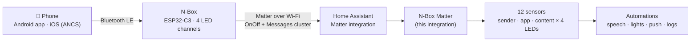

<p align="center">
  
</p>

<h1 align="center">N-Box Matter for Home Assistant</h1>

<p align="center">
  <b>Your phone's notifications — who sent them, from which app, and what they say — as Home Assistant sensors.</b><br>
  Android and iOS, delivered over <b>Matter</b>. No cloud, no polling, no accounts.
</p>

<p align="center">
  <a href="https://hacs.xyz"></a>
  
  
  
</p>

---

## What is this?

The **N-Box** is a small ESP32-C3 device with four LED notification channels. It listens to your phone
over Bluetooth LE (an Android companion app, or Apple's Notification Center Service on iOS), lights the
LED that matches a rule you set (a person, an app, a keyword…), and **tells Home Assistant over Matter**.

Matter on its own only carries the LED state (*on* = "something new arrived"). The notification itself —
**sender, app and message text** — travels in a Matter *Messages* cluster on the same endpoint.

**This integration reads that cluster and turns it into three plain text sensors per LED.**
That is all an automation needs to say *"New WhatsApp from Anna: running late"* on a smart speaker, flash a
light for one person only, forward a message to a dashboard, or ignore a noisy app at night.



## Features

- **Sender, app and content as sensors** for each of the four LED channels (12 sensors).
- **Local push**: the N-Box reports over Matter; nothing leaves your network.
- **Works with iOS and Android** — the phone side lives in the N-Box and its companion app; Home Assistant
  sees the same data either way.
- **One device per LED channel** (*N-Box LED 1…4*), with the matching Matter light grouped into it.
- **Configurable from the UI**: Matter node and the light that signals each LED; a *scan* button finds the node number for you.
- Pure Python, no extra requirements, no YAML.

## Requirements

| What | Notes |
|---|---|
| Home Assistant with the **Matter** integration | Required dependency (`dependencies: ["matter"]`) |
| An **N-Box** commissioned into Home Assistant through Matter | It shows up as four *Light* entities (one per LED channel) |
| The phone side | Android companion app, or iOS notifications through ANCS |

> The N-Box firmware (ESP-IDF + ESP-Matter) and the Android companion app are separate projects by the
> same author and are **not part of this repository yet**.

## Installation

### HACS (custom repository)

1. HACS → ⋮ → **Custom repositories** → add `https://github.com/kitsuneb2/NBox-HomeAssistant`, category **Integration**.
2. Download **N-Box Matter**, then restart Home Assistant.

### Manual

Copy `custom_components/nbox_matter` into your Home Assistant `config/custom_components/` folder and restart.

## Setup

1. Pair the N-Box with Home Assistant through **Matter** first (it must appear in the Matter integration).
2. **Settings → Devices & Services → Add Integration → N-Box Matter Extension.**
3. The form asks for:

   | Field | Meaning |
   |---|---|
   | **Matter Node ID** | Node number of the N-Box in the Matter server (auto-filled when it can be discovered) |
   | **LED 1–4 Trigger Entity** | The Matter *Light* that goes **on** when a notification arrives for that LED (default `light.n_box_light_1` … `_4`) |

4. To change them later: **Configure** on the integration. Tick **Auto-Discover Node ID** and submit to scan, then submit again to save.

### How the node number is found

The N-Box's Matter light belongs to a device whose Matter identifier ends in the node number as hex
(for example `…-000000000000007F-…` = node **127**). The integration looks at the trigger light, reads that
identifier and converts it.

## Entities

For every LED channel `N` = 1…4:

| Entity | Example value |
|---|---|
| `sensor.n_box_ledN_sender` | `Anna` |
| `sensor.n_box_ledN_app` | `WhatsApp` |
| `sensor.n_box_ledN_content` | `Running late, start without me` |

Before the first message the sensors show `Waiting for data...`; a cleared notification shows `None`.
The sensors are grouped into a device called **N-Box LED N**.

## The message format

The N-Box publishes the **Matter Messages cluster** (`0x0097`, cluster 151) on endpoints 1–4. The
`Messages` attribute (id 0) holds one `MessageStruct` whose `messageText` is:

```
sender|app|content
```

and `None|None|None` when the notification is cleared. The integration splits that string into the three
sensors. Only the first two `|` are separators, so message text may contain `|` itself.

## Timing

1. A notification arrives: the N-Box toggles the LED's light **off → on** (so Home Assistant always sees a
   state change) and then updates the message text.
2. When the trigger light turns on, the integration waits **1 second** and then reads the Messages attribute
   from the Matter node. It also reads once at start-up.

In your automations, trigger on the **light** and give the sensors a moment (2–3 s) before reading them.

## Automation examples

**Announce app and sender**

```yaml
alias: N-Box - announce new message (LED 1)
triggers:
  - trigger: state
    entity_id: light.n_box_light_1
    to: "on"
actions:
  - delay: "00:00:03"            # let the sensors update (the integration reads after 1 s)
  - variables:
      app: "{{ states('sensor.n_box_led1_app') }}"
      sender: "{{ states('sensor.n_box_led1_sender') }}"
  - condition: template
    value_template: "{{ app not in ['unknown', 'unavailable', 'None', 'Waiting for data...'] }}"
  - action: notify.mobile_app_my_phone
    data:
      message: >-
        New {{ app }}{{ ' from ' ~ sender if sender not in ['Unknown', 'None'] else '' }}
```

**Different reaction per app**

```yaml
actions:
  - delay: "00:00:03"
  - choose:
      - conditions: "{{ is_state('sensor.n_box_led1_app', 'WhatsApp') }}"
        sequence:
          - action: light.turn_on
            target: { entity_id: light.hallway }
            data: { color_name: green, flash: short }
      - conditions: "{{ is_state('sensor.n_box_led1_app', 'Calendar') }}"
        sequence:
          - action: tts.speak
            target: { entity_id: tts.home_assistant_cloud }
            data:
              media_player_entity_id: media_player.kitchen
              message: "Reminder: {{ states('sensor.n_box_led1_content') }}"
```

**Quiet hours:** add a `condition: state` on a sleep helper, so the N-Box still lights its LED but Home Assistant stays silent.

## Troubleshooting

| Symptom | Likely cause |
|---|---|
| Sensors stay at `Waiting for data...` | The Matter **node ID** in the settings is not the N-Box's current node, or the node is offline. |
| The same old app keeps being announced | The trigger lights in the settings are not the live ones (for example **unavailable leftovers** of a removed N-Box), so the sensors are never refreshed. |
| Settings point at nothing after re-pairing | Removing and pairing the N-Box again gives it a **new node number** and new light entities. Update the integration's node ID and trigger lights (see Setup). |
| Nothing in the log | By design the integration only logs setup steps (as `[NBOX]` / `[NBOX DISCOVERY]`) and read failures at debug level. See the roadmap. |

To see what exists, open **Settings → Devices & Services → Matter**, find the N-Box and check its node
number in the device info.

## Known limitations and roadmap

This is a young integration that grew with the hardware. Planned work:

- [ ] **Automatic re-discovery when the N-Box is paired again** (new node number, new light entities), without touching the settings.
- [ ] Discovery that ignores orphaned entities and prefers the **available** Matter lights.
- [ ] **Subscribe to Matter attribute updates** instead of reading 1 s after the light changes (no timing race, no dependency on the trigger light).
- [ ] Log the **raw message** received and the three parts, at debug level, for easy diagnosis.
- [ ] An **event entity** per LED, so automations can trigger directly on a received message.
- [ ] Clean entity names without numeric suffixes after re-installation.
- [ ] Translations, tests and a diagnostics download.

Ideas and bug reports are very welcome — open an issue.

## Credits

Built for the **N-Box** ("N-Sync") notification device. Matter message handling uses Home Assistant's own
Matter client. Released under the [MIT License](LICENSE).
