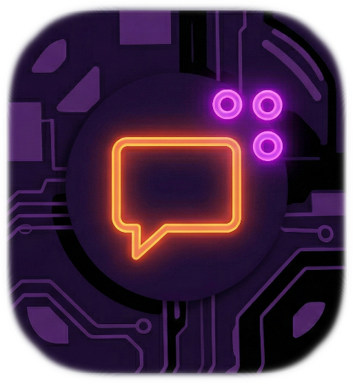
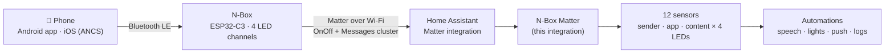

<p align="center">
  
</p>

<h1 align="center">N-Box Matter for Home Assistant</h1>

<p align="center">
  <b>Your phone's notifications — who sent them, from which app, and what they say — as Home Assistant sensors.</b><br>
  Android and iOS, delivered over <b>Matter</b>. No cloud, no polling, no accounts, and no setup to repeat when you pair the device again.
</p>

<p align="center">
  <a href="https://hacs.xyz"></a>
  
  
  
  
</p>

---

## What is this?

The **N-Box** is a small ESP32-C3 device with four LED notification channels. It listens to your phone
over Bluetooth LE (an Android companion app, or Apple's Notification Center Service on iOS), lights the
LED that matches a rule you set (a person, an app, a keyword…), and **tells Home Assistant over Matter**.

Matter on its own only carries the LED state (*on* = "something new arrived"). The notification itself —
**sender, app and message text** — travels in a Matter *Messages* cluster on the same endpoint.

**This integration reads that cluster and turns it into three plain text sensors per LED.**
That is all an automation needs to say *"New WhatsApp from Anna: running late"* on a smart speaker, flash a
light for one person only, forward a message to a dashboard, or ignore a noisy app at night.



## Features

- **Sender, app and content as sensors** for each of the four LED channels (12 sensors).
- **Self-healing.** The N-Box is found automatically. Remove it and pair it again — new node number, new
  entities — and the integration switches over by itself and tidies up what the old pairing left behind.
- **Instant.** It subscribes to the Matter server, so a message shows up the moment the N-Box reports it.
- **Local push**: nothing leaves your network.
- **Works with iOS and Android** — the phone side lives in the N-Box and its companion app; Home Assistant
  sees the same data either way.
- **Nothing to configure**: one confirmation at setup. Optional pin-to-node and clean-up switch in *Configure*.
- Pure Python, no extra requirements, no YAML.

## Requirements

| What | Notes |
|---|---|
| Home Assistant with the **Matter** integration | Required dependency (`dependencies: ["matter"]`) |
| An **N-Box** commissioned into Home Assistant through Matter | It shows up as a *N-Box* device with four *Light* entities |
| The phone side | Android companion app, or iOS notifications through ANCS |

> The N-Box firmware (ESP-IDF + ESP-Matter) and the Android companion app are separate projects by the
> same author and are **not part of this repository yet**.

## Installation

### HACS (custom repository)

1. HACS → ⋮ → **Custom repositories** → add `https://github.com/kitsuneb2/NBox-HomeAssistant`, category **Integration**.
2. Download **N-Box Matter**, then restart Home Assistant.

### Manual

Copy `custom_components/nbox_matter` into your Home Assistant `config/custom_components/` folder and restart.

## Setup

1. Pair the N-Box with Home Assistant through **Matter** (it must appear in the Matter integration).
2. **Settings → Devices & Services → Add Integration → N-Box Matter → Submit.**

That is all. The screen tells you whether an N-Box was found; if it is not paired yet, the integration
waits and picks it up as soon as it is.

**Upgrading from 2.x:** just update and restart. The old node number and trigger-light options are not needed
any more and are dropped on first start; lights that 2.x had pulled into its own devices are moved back to
the N-Box's Matter device.

### Options (Configure)

| Option | Meaning |
|---|---|
| **Matter node number** | `0` = detect automatically (recommended). Set a number only if you own several N-Boxes and want to pin one. |
| **Auto cleanup** | On by default. Removes the leftover entities (and empty devices) of N-Box nodes that no longer exist after a re-pairing. Only nodes this integration recognised as an N-Box are ever touched. |

## How it finds and follows the N-Box

1. It looks through the Matter nodes for one that **is** an N-Box: vendor `BRS-L`, product `N-Box` (or the
   vendor/product ids `0xFFF2`/`0x8001`; as a fallback, a node publishing the Messages cluster on several endpoints).
2. It subscribes to that node's *Messages* attribute on endpoints 1–4 and reads the current values.
3. It also listens for Matter nodes being added, updated or removed. If the N-Box is removed and paired again, the
   integration picks the new node, resubscribes, re-reads all channels, moves any light that an older version
   had pulled into its devices back to Matter, and (unless switched off) removes the leftovers of the old node.
4. A safety re-read runs every minute.

If more than one N-Box is paired, the available one is used, preferring the newest — or pin one in *Configure*.

## Entities

For every LED channel `N` = 1…4:

| Entity | Example value |
|---|---|
| `sensor.n_box_ledN_sender` | `Anna` |
| `sensor.n_box_ledN_app` | `WhatsApp` |
| `sensor.n_box_ledN_content` | `Running late, start without me` |

- `Waiting for data...` – an N-Box was found but has not reported a message on this channel yet.
- `None` – the notification was cleared.
- `unavailable` – there is no N-Box on Matter, or its node is offline.
- Attribute `matter_node_id` – the Matter node currently in use.

The sensors are grouped into devices called **N-Box LED N**. Entity ids and unique ids are the same as in 2.x.

## The message format

The N-Box publishes the **Matter Messages cluster** (`0x0097`, cluster 151) on endpoints 1–4. The
`Messages` attribute (id 0) holds one `MessageStruct` whose `messageText` is:

```
sender|app|content
```

and an empty list (or `None|None|None`) when the notification is cleared. The integration splits that string
into the three sensors. Only the first two `|` are separators, so message text may contain `|` itself.
The N-Box may shorten long names and texts before sending them.

## Timing

A notification arrives: the N-Box toggles the LED's light **off → on** (so Home Assistant always sees a state
change) and updates the message text. The sensors update as soon as the N-Box reports the text — typically
within a fraction of a second of the light changing. In an automation that triggers on the light, a short
`delay` (1–2 s) before reading the sensors is a cheap way to be sure they are up to date.

## Automation examples

**Announce app and sender**

```yaml
alias: N-Box - announce new message (LED 1)
triggers:
  - trigger: state
    entity_id: light.n_box_light_1
    to: "on"
actions:
  - delay: "00:00:02"            # let the sensors update
  - variables:
      app: "{{ states('sensor.n_box_led1_app') }}"
      sender: "{{ states('sensor.n_box_led1_sender') }}"
  - condition: template
    value_template: "{{ app not in ['unknown', 'unavailable', 'None', 'Waiting for data...'] }}"
  - action: notify.mobile_app_my_phone
    data:
      message: >-
        New {{ app }}{{ ' from ' ~ sender if sender not in ['Unknown', 'None'] else '' }}
```

**Trigger straight on the message (no light needed)**

```yaml
triggers:
  - trigger: state
    entity_id: sensor.n_box_led1_content
conditions:
  - condition: template
    value_template: "{{ trigger.to_state.state not in ['None', 'unavailable', 'unknown', 'Waiting for data...'] }}"
```

**Different reaction per app**

```yaml
actions:
  - delay: "00:00:02"
  - choose:
      - conditions: "{{ is_state('sensor.n_box_led1_app', 'WhatsApp') }}"
        sequence:
          - action: light.turn_on
            target: { entity_id: light.hallway }
            data: { color_name: green, flash: short }
      - conditions: "{{ is_state('sensor.n_box_led1_app', 'Calendar') }}"
        sequence:
          - action: tts.speak
            target: { entity_id: tts.home_assistant_cloud }
            data:
              media_player_entity_id: media_player.kitchen
              message: "Reminder: {{ states('sensor.n_box_led1_content') }}"
```

**Quiet hours:** add a `condition: state` on a sleep helper, so the N-Box still lights its LED but Home Assistant stays silent.

## Troubleshooting

| Symptom | What to check |
|---|---|
| Sensors are `unavailable` | No N-Box is paired on Matter, or its node is offline. Check **Settings → Devices & Services → Matter**. |
| Sensors stay at `Waiting for data...` | The N-Box is found but has not reported a message yet. Send yourself a notification on a phone that is connected to it. |
| I paired the N-Box again | Nothing to do — it is picked up automatically (watch the log for `[NBOX] Using N-Box on Matter node …`). |
| Leftover `unavailable` lights from an old pairing | Enabled by default: they are removed automatically. If *Auto cleanup* is off, delete them by hand. |
| Nothing is announced although the sensors look right | Check the rest of your automation (for example the text-to-speech or media player step); the integration only provides the sensors. |

### Seeing what is received

Add this to `configuration.yaml` and restart (or use the *Set log level* action):

```yaml
logger:
  logs:
    custom_components.nbox_matter: debug
```

Every message is then logged as `[NBOX] EPn (update|read): sender=… app=… content=…`, together with the node
selection and clean-up steps. Setup and node changes are logged at info level as `[NBOX] …`.

## Roadmap

- [ ] An **event entity** per LED, so automations can trigger directly on a received message.
- [ ] Repairs issue when no N-Box is found for a long time.
- [ ] Translations, a test suite in CI and a diagnostics download.

Ideas and bug reports are very welcome — open an issue.

## Credits

Built for the **N-Box** ("N-Sync") notification device. Matter message handling uses Home Assistant's own
Matter client. Released under the [MIT License](LICENSE).
